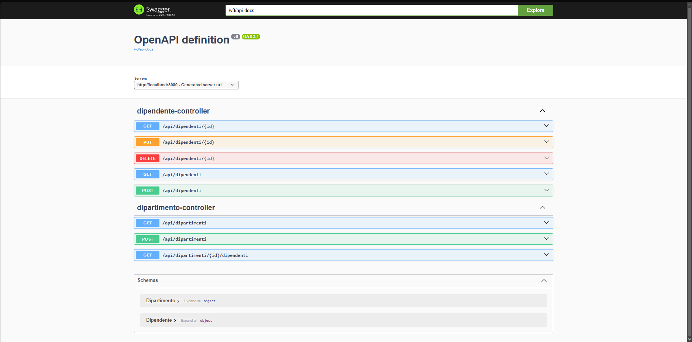

# Gestionale Dipendenti – RESTful API

Servizio web RESTful sviluppato in **Java 21 e Spring Boot** per la gestione aziendale di dipendenti e dipartimenti, progettato seguendo un'architettura a livelli (*Controller, Service, Repository*) e i principi OOP / Dependency Injection.

## Stack Tecnologico
- **Backend:** Java 21, Spring Boot, Spring Web
- **Persistenza & Database:** Spring Data JPA (Hibernate), MySQL
- **Validazione & Documentazione:** Jakarta Bean Validation, Springdoc OpenAPI (Swagger UI)

## Architettura e Funzionalità
- **Modellazione Relazionale:** relazione `@ManyToOne` / `@OneToMany` tra `Dipendente` e `Dipartimento`.
- **Operazioni CRUD complete:** creazione, lettura (con filtro per ruolo o dipartimento), aggiornamento ed eliminazione.
- **Gestione Centralizzata delle Eccezioni:** `@RestControllerAdvice` per risposte JSON standardizzate (`400 Bad Request` sugli errori di validazione, `404 Not Found` sulle risorse inesistenti).

## Documentazione Interattiva (Swagger UI)


## Endpoint Principali
| Metodo | Endpoint | Descrizione |
| :--- | :--- | :--- |
| `GET` | `/api/dipartimenti` | Restituisce tutti i dipartimenti |
| `POST` | `/api/dipartimenti` | Crea un nuovo dipartimento |
| `GET` | `/api/dipartimenti/{id}/dipendenti` | Elenca i dipendenti assegnati a un dipartimento |
| `GET` | `/api/dipendenti` | Elenca tutti i dipendenti (supporta `?ruolo=...`) |
| `GET` | `/api/dipendenti/{id}` | Restituisce il dettaglio di un singolo dipendente |
| `POST` | `/api/dipendenti?dipartimentoId=1` | Crea un dipendente associandolo a un dipartimento |
| `PUT` | `/api/dipendenti/{id}` | Aggiorna i dati di un dipendente |
| `DELETE` | `/api/dipendenti/{id}` | Elimina un dipendente |

## Avvio Locale
**Requisiti:** Java 21 e MySQL Server in esecuzione in locale.

1. Impostare le credenziali del database tramite variabili d'ambiente: `DB_USERNAME` (opzionale, default `root`) e `DB_PASSWORD`. Il database `gestionale_dipendenti` e le relative tabelle vengono creati automaticamente all'avvio.
   ```powershell
   # Windows (PowerShell)
   $env:DB_PASSWORD="la_tua_password"
   ```
   ```bash
   # Linux / macOS
   export DB_PASSWORD="la_tua_password"
   ```
2. Eseguire l'applicazione tramite Maven:
   ```bash
   ./mvnw spring-boot:run
   ```
3. Aprire nel browser la documentazione interattiva all'indirizzo:
   `http://localhost:8080/swagger-ui/index.html`